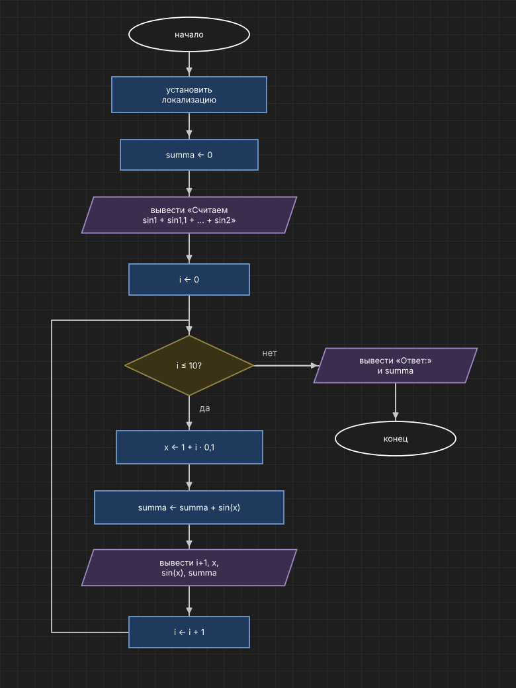

# Домашнее задание к работе 8
 
## Вариант 14
 
## Условие задачи
 
Вычислите с использованием цикла for значение:
 
sin1 + sin1,1 + sin1,2 + ... + sin2
 
## 1. Алгоритм и блок-схема
 
### Алгоритм
 
1. Начало.
2. Установить локализацию.
3. Вывести, какое выражение считаем.
4. Вызвать функцию `summa = summa_sin(1, 2, 0,1)`:
   - `s = 0`;
   - `kolvo = round((konec − nachalo) / shag)`;
   - цикл `for` по `i` от 0 до `kolvo`: `s = s + sin(nachalo + i · shag)`;
   - вернуть `s`.
5. Вывести ответ `summa`.
6. Конец.
### Блок-схема
 

 
## 2. Реализация программы
 
```c
#define _CRT_SECURE_NO_WARNINGS
#include <stdio.h>
#include <math.h>
#include <locale.h>
 
double summa_sin(double nachalo, double konec, double shag);
 
int main()
{
    double summa;
 
    setlocale(LC_ALL, "Rus");
 
    printf("Считаем sin1 + sin1,1 + sin1,2 + ... + sin2\n");
 
    summa = summa_sin(1, 2, 0.1);
 
    printf("Ответ: %f\n", summa);
 
    return 0;
}
 
double summa_sin(double nachalo, double konec, double shag)
{
    double s = 0;
    int i, kolvo;
    kolvo = (int)((konec - nachalo) / shag + 0.5);
    for (i = 0; i <= kolvo; i++)
        s += sin(nachalo + i * shag);
    return s;
}
```
 
## 3. Результаты работы программы
 
```
Считаем sin1 + sin1,1 + sin1,2 + ... + sin2
Ответ: 10,431904
```
 
## 4. Информация о разработчике
 
Кочергин Савелий, группа бИД-261
